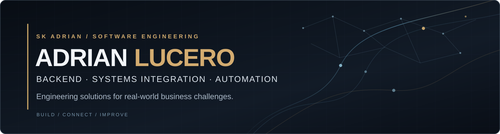

  

  <strong>Software Engineer · Backend · Systems Integration · Automation</strong> 
  Building practical software for real operational and business challenges.

  <a href="docs/README.pt-BR.md">Português (Brasil)</a> ·
  <a href="https://www.linkedin.com/in/adrian-lucero-6ab2b7259/">LinkedIn</a> ·
  <a href="mailto:adrian.skcorp@gmail.com">Email</a>

---

### What I do

I'm **Adrian Lucero**, a Computer Science student and software developer based in Brazil. I work across backend engineering, APIs, systems integration, operational applications and automation, turning complex workflows into maintainable software.

I combine hands-on development with an understanding of business operations. I also use AI-assisted development tools for research, implementation and testing, while keeping technical decisions and verification explicit.

### Two ways to work together

| For engineering teams | For businesses |
| :--- | :--- |
| **Considering me for a software role?** Explore my technical work and engineering approach. | **Need a system, integration or automation?** Let's discuss the problem and a practical scope. |
| [**Connect on LinkedIn →**](https://www.linkedin.com/in/adrian-lucero-6ab2b7259/) | [**Discuss a project →**](mailto:adrian.skcorp@gmail.com?subject=Software%20Project%20Inquiry) |

### Selected work

#### Business operations software · Professional work

Backend services, operational interfaces and third-party system integrations built around real business workflows. Experience includes tracking-related processes, REST APIs, data persistence and role-based access.

**Focus:** Python · FastAPI · React · SQL · API integration  
**Code:** Private / employer-related. No internal screenshots, sensitive architecture or company data are published here.

#### Software licensing infrastructure · Private engineering project

A TypeScript-based licensing and authorization system with an API, administrative interface and consumer SDK. Work includes signed capabilities, verification, auditability and license state management.

**Focus:** TypeScript · Fastify · PostgreSQL · SDK design  
**Status:** Private development and local validation; not presented as a production service.

#### Device-tracking platform · Private engineering project

An evolving platform combining device-location ingestion with a backend, operational dashboards and administration for multiple organizations.

**Focus:** Fastify · PostgreSQL · React · Mobile integration  
**Status:** In development / controlled validation.

#### Public repositories

- **[Log Anomaly Detector](https://github.com/SkAdr1an/log-anomaly-detector)** — A Python demonstration project for log analysis, anomaly detection and report generation.
- **[HelpDesk Laravel](https://github.com/SkAdr1an/helpdesk-laravel)** — A ticket-management application exploring Laravel MVC, authentication, user-specific authorization and CRUD workflows.

> For private work, descriptions above are intentionally high-level. Detailed case studies and metrics will be published only after verification and disclosure approval.

[**Explore the public engineering samples and their limitations →**](docs/public-projects.md)

### Engineering focus

| Backend & integration | Applications & data | Delivery & tooling |
| :--- | :--- | :--- |
| Python, FastAPI, Node.js, Fastify, REST APIs | TypeScript, React, SQL, PostgreSQL, SQLite | Git, Docker, automated tests, AI-assisted workflows |

**How I approach problems:** understand the process → define the boundaries → implement and test → document trade-offs → improve based on evidence.

### Current direction

- Building maintainable backend services and integrations.
- Strengthening application security, testing, system design and delivery practices.
- Turning operational requirements into measurable software outcomes.
- Learning continuously through Computer Science studies and real engineering projects.

---

  <strong>Engineering solutions for real-world business challenges.</strong> 
  <a href="https://www.linkedin.com/in/adrian-lucero-6ab2b7259/">Professional opportunities</a>
  &nbsp;·&nbsp;
  <a href="mailto:adrian.skcorp@gmail.com?subject=Software%20Project%20Inquiry">Business inquiries</a>
  &nbsp;·&nbsp;
  <a href="docs/README.pt-BR.md">Leia em português</a>

